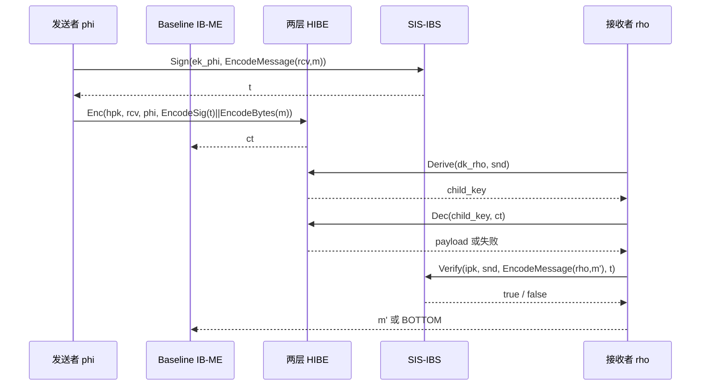

# M3 方案流程图、算法说明与安全边界

## 1. 一句话说明

发送者用自己的身份签名并指定接收者，接收者只有用自己的接收者密钥并尝试正确的发送者身份，才能同时通过两层 HIBE 解密和 IBS 验签。

## 2. 系统流程图

```mermaid
flowchart TD
    A[Setup 参数] --> B[HIBE.Setup]
    A --> C[IBS.Setup]
    B --> D[HIBE 公钥 hpk / 主密钥 hmsk]
    C --> E[IBS 公钥 ipk / 主密钥 imsk]
    D --> F[协议公钥 mpk=(hpk,ipk)]
    E --> F
    D --> G[协议主密钥 msk=(hmsk,imsk)]
    E --> G

    G --> H[SKGen: IBS.KeyExt imsk, phi]
    G --> I[RKGen: HIBE.Extract hmsk, rho]
    H --> J[发送者密钥 ek_phi]
    I --> K[接收者第一层密钥 dk_rho]

    J --> L[EncodeMessage rcv,m]
    L --> M[IBS.Sign ek_phi]
    M --> N[载荷 EncodeSignature t || EncodeBytes m]
    N --> O[HIBE.Enc hpk, rcv, phi]
    O --> P[密文 ct]

    P --> Q[HIBE.Derive dk_rho, snd]
    Q --> R[HIBE.Dec]
    R --> S{严格解析载荷}
    S -->|失败| T[BOTTOM]
    S -->|成功| U[IBS.Verify ipk, snd, EncodeMessage rho,m',t]
    U -->|失败| T
    U -->|成功| V[返回 m']
```

## 3. 解密时序图



## 4. 算法说明

### 4.1 规范编码

所有身份、消息和签名材料先转为字节串，再使用长度前缀和域分隔：

```text
EncodeBytes(x)   = uint32_be(len(x)) || x
EncodeIdentity(x)= DOMAIN_ID || EncodeBytes(x)
EncodePair(a,b)  = DOMAIN_PAIR || EncodeBytes(a) || EncodeBytes(b)
EncodeMessage(i,m)= DOMAIN_MSG || EncodeBytes(i) || EncodeBytes(m)
```

这一步防止 `("ab", "c")` 与 `("a", "bc")` 之类的拼接歧义。解析器在任何字段缺失、长度越界、尾随垃圾或域不匹配时失败。

### 4.2 两层格基 HIBE

ABB10 后端的核心矩阵关系是：

$$
A=[\bar A\mid G-\bar A R_A],
$$

第一层身份矩阵 $H(\rho)$ 通过域分隔 SHAKE-256 生成；`Extract` 构造 $R_1$ 使：

$$
A R_1+G=H(\rho).
$$

第二层使用身份对矩阵 $H(\rho,\phi)$，构造 $R_2$ 使：

$$
B_\rho R_2+G=H(\rho,\phi),
\quad B_\rho=[A\mid H(\rho)].
$$

由此得到第二层矩阵：

$$
B_{\rho,\phi}=[A\mid H(\rho)\mid H(\rho,\phi)].
$$

M3 的密文采用逐明文位独立的 Regev 样本。令 $b_j$ 为结构化明文的第 $j$ 位，独立采样 $s_j$、$e_1^{(j)}$、$e_2^{(j)}$：

$$
c_2^{(j)}=B_{rcv,\phi}^{T}s_j+e_2^{(j)},
$$

$$
c_{1,j}=u^Ts_j+e_1^{(j)}+b_j\lfloor q/2\rfloor.
$$

解密方用第二层陷门为 $u$ 生成短原像 $x$，使 $B_{\rho,snd}x=u$，然后计算：

$$
v_j=c_{1,j}-\langle x,c_2^{(j)}\rangle.
$$

以 $q/4$ 为阈值恢复每一位，再严格解析出 `rcv'`、`phi'` 和 payload，并与接收者密钥中的身份做常数时间比较。

逐位独立采样是当前版本的结构性修复：旧版本共享同一个 $s$ 时，`c1[j]-c1[0]` 会消除公共 $u^Ts$，形成可聚类的明文差分。修复后每个位置包含独立随机分量，但代价是密文体积和加密时间都按 bit 数增长。

### 4.3 SIS-IBS

SIS-IBS 使用：

$$
H_1(mpk,id)=A\widehat R_{id}+G,
\quad F_{id}=[A\mid H_1(mpk,id)].
$$

`KeyExt` 利用主陷门为身份生成短的 $\widehat R_{id}$。对消息 $m$ 计算：

$$
h_2=H_2(mpk,id,m),
$$

并采样签名向量 $z$ 满足：

$$
F_{id}z=h_2\pmod q.
$$

验证检查 $z\ne0$、矩阵等式和范数界。协议中签名的消息是 `EncodeMessage(receiver_id, message)`，因此改接收者、改消息或改发送者身份都会使验证失败。

## 5. 身份匹配逻辑

```text
加密身份：      (rcv, phi)
接收者派生身份：(rho, snd)

HIBE 成功需要：  rho = rcv 且 snd = phi
IBS 成功需要：   t 是 snd 对 EncodeMessage(rho,m') 的合法签名
```

两层 HIBE 负责“能否取出候选载荷”，IBS 负责“候选载荷是否由声称的发送者为该接收者和消息生成”。任何失败都映射到 `BOTTOM`，不返回部分明文。

## 6. 安全边界

### 6.1 当前实现可以声称的内容

- 在测试参数和测试覆盖范围内，匹配身份可正确恢复消息；
- 非匹配身份、格式错误、签名篡改和随机伪造被协议映射为 `BOTTOM`；
- 密文格式不直接携带身份明文，CLI 文件名不直接携带身份原文；
- 生产代码默认使用系统随机源，测试使用可复现随机源；
- 代码实现了基线协议的接口和功能流程。

### 6.2 当前实现不能声称的内容

- 不能声称任何 NIST Level 或其他安全等级；
- 不能声称 LWE、SIS、HIBE、IBS 或 IB-ME 已完成安全证明；
- 不能声称标准模型安全；
- 不能把基线方案说成 Boyen–Li 增强隐私方案；
- 不能声称已实现 `Ext`、`ReExt` 或身份熵条件；
- 不能把有限次功能测试写成 IND-CPA、UF-CMA 或匿名性证明；
- 不能把 mock 后端当作密码学实现；
- 不能把当前纯 Python 教学基准外推为生产性能。

### 6.3 需要主动披露的工程限制

| 限制 | 影响 |
|---|---|
| 极小教学参数 | 没有安全等级含义 |
| 简化 TrapGen/SamplePre | 输出分布未达到证明级要求 |
| ROM 风格 SHAKE-256 哈希 | 不是标准模型构造 |
| 逐位独立 LWE v2 | 修复共享掩码泄漏，但密文很大、加密很慢 |
| HIBE 直接承载 payload | 消息受 `max_message_bytes` 限制，尚无 AEAD 混合包装 |
| 采样拒绝循环 | 非常数时间，存在侧信道工程风险 |
| M4 未实现 | 当前没有 Boyen–Li 增强隐私 |

## 7. 比赛中的标准表述

建议使用：

> 本作品实现的是指导论文第三章的基线 IB-ME 参考原型。它采用教学参数，`security_claim: none`，测试用于验证功能和接口，不替代密码学安全证明。Boyen–Li 论文中的 `Ext`、`ReExt` 增强隐私部分属于后续 M4，当前版本没有实现。

不建议使用：“达到某 NIST 等级”“已经证明安全”“实现了完整增强隐私”“可直接生产部署”。

