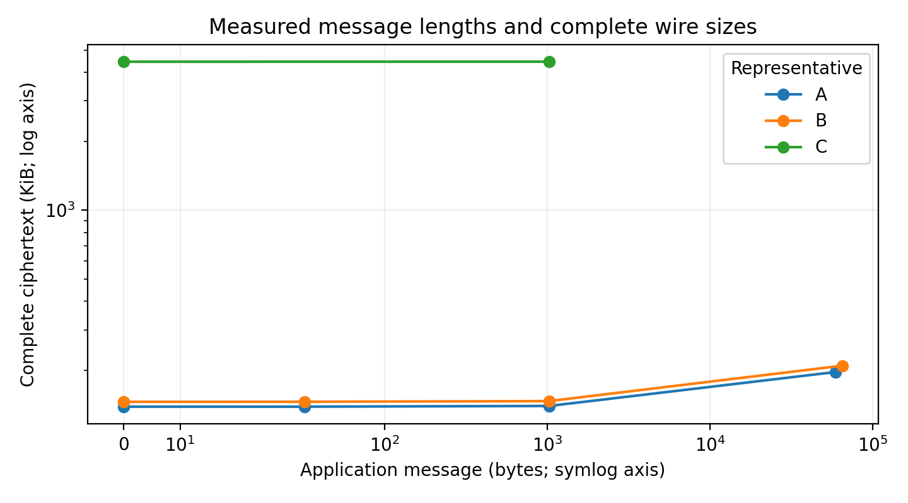

# 报告第二项：实验主表与必要补测

批次于2026-10-19开始、2026-10-20完成。运行工具与原语源码固定为 `eeb3108fc634a2d3d56b329c62f528414965e05d`；三份 Suite 保持第一项选型的原值。

**本批新增同机 A/B 重复基准、三组精确配置的仓库外安装验收、消息长度补测和有效外层／无效内层签名负例。** 没有修改原语、采样器或默认参数，没有替换 PARAM-I；旧作品报告、新报告正文和PPT均未改。

A/B使用相同wheel、i9-14900HX、WSL2、Sage 10.7／Python 3.12.13、NumPy 2.4.3、cryptography 50.0.2、OMP4／OPENBLAS1；Python安装代码和运行状态位于WSL文件系统，原生桥复用本机现有路径，详见安装及环境记录。两组顺序运行，彼此不并发。C功能批次在二者之后执行。系统页缓存与已构建原生引擎保留。

参数来源、完整数值及逐部件模型沿用[第一项冻结说明](../2026-10-19-report-three-selection/README.md#冻结的实际配置)及其三份Suite：A/B的LATTE为N=1024、q=68718428161；A使用BNN/ML-DSA-44，B使用SRGG论文PARAM-I factor1／table-standard-deviation／compact；C为Lai n2048、q274877976577与Sageloli环v3 PARAM-I d2048/k65/l132。参数来自选定论文／既有研究配方，不是教学调试参数；逐部件ROM/QROM引用条件见该说明，不新增完整系统的模型安全声明。

## 完整系统重复基准

A/B各3个独立系统CSPRNG根，每根生成进程执行3对warm，另起1个恢复进程加载对象后解密3次；每组共3个恢复进程、9对warm和9次恢复后解密，64 B身份／32 B应用消息。Setup／发钥／首次操作／对象恢复各3个观测，warm与恢复后解密各9个观测。表中均为秒、中位数，包含公开协议、对象验证、wire编解码和原生调用。

| 操作 | A：LATTE＋BNN/ML-DSA | B：LATTE＋SRGG |
|---|---:|---:|
| Setup | 1.117252 | 1.598913 |
| 发送者发钥 | 0.095386 | 32.066890 |
| 接收者发钥 | 0.426875 | 0.456980 |
| 生成进程首次加密 | 0.096330 | 9.142216 |
| 首次解密（含叶生成） | 0.283574 | 0.238744 |
| 热加密 | 0.078473 | 9.172154 |
| 热解密 | 0.151951 | 0.160670 |
| 新进程对象恢复 | 0.844533 | 0.889801 |
| 恢复后解密 | 0.153717 | 0.133632 |

每个配置有3个cold和9个warm完整密文，共12个wire尺寸观测。warm共享各自根，不是9个独立根；两组目标参数／安全组不同，**同机同版本不等于等安全，不计算算法优劣排名或安全等级**。C没有新增重复基准，不能把其单根CLI时间填进上表。

| 字节数／采样内存 | A | B |
|---|---:|---:|
| 协议公钥 | 14,363—14,388 | 47,265—47,362 |
| 协议主状态 | 177,466—177,750 | 268,096—268,450 |
| 发送者钥 | 8,050—8,050 | 84,242—84,476 |
| 接收者状态 | 127,950—128,186 | 128,058—128,243 |
| 完整密文 | 142,066—142,123 | 149,204—149,273 |
| 进程树RSS采样最大值 | 482,492,416 | 508,166,144 |

## 精确配置安装、长度和拒绝

从固定源码构建wheel，在新的隔离目录安装，从仓库外启动；所有已加载项目provider必须位于该安装目录且与wheel及固定Git源码一致，混入仓库源码即失败。原生桥复用已构建的同源版本，并由实际后端执行ABI／source ID检查。

| 组合 | 实际消息长度（B） | CLI命令／另行协议负例进程 | 恢复 |
|---|---|---:|---|
| A：LATTE＋BNN/ML-DSA-44 | 0、32、1,024、59,191 | 24／1 | 新进程，零新熵，原状态不变 |
| B：LATTE＋SRGG PARAM-I compact | 0、32、1,024、65,364 | 24／1 | 新进程，零新熵，原状态不变 |
| C：Lai C2＋Sageloli RSIS v3 PARAM-I | 0、1,024 | 16／1 | 新进程，实际重新Lai委派，原状态不变 |

每组都是1个新CSPRNG根；与重复基准的6个根分开计数，本批共9个独立完整组合初始化。B安装时显式128 KiB Hybrid预算，Suite摘要与第一项B完全一致，补上旧64 KiB安装记录不能继承的缺口。C使用完整C2数值和v3 PARAM-I、8 MiB载荷，不降回默认n256或debug参数。零熵指项目SecureRandom计数及原生/协议生成守卫，不指解释器启动的全系统熵消耗。

A/B另外实跑三种身份错配；三组均实跑容量+1、身份+1、截断、追加、重复、末字节修改。容量/身份越界在零熵保护下拒绝、无密文输出且原状态不变。C未在本批重复三种身份错配，其原32 B四身份情形继续引用上一批，不能计为本次新增。

| 组合 | 应用消息（B） | 完整密文（B） | CLI加密主过程（s） | CLI解密主过程（s） |
|---|---:|---:|---:|---:|
| A | 0 | 142,065 | 0.683042 | 1.557047 |
| A | 32 | 142,093 | 0.566109 | 1.358288 |
| A | 1,024 | 143,096 | 0.436009 | 1.517947 |
| A | 59,191 | 201,268 | 0.538318 | 1.723461 |
| B | 0 | 149,209 | 19.282968 | 1.376191 |
| B | 32 | 149,272 | 10.348994 | 1.270655 |
| B | 1,024 | 150,270 | 9.859425 | 1.312317 |
| B | 65,364 | 214,615 | 9.654759 | 1.388494 |
| C | 0 | 4,555,404 | 139.442768 | 626.750446 |
| C | 1,024 | 4,556,428 | 123.754582 | 496.194357 |

CLI主过程包含持久状态加载／校验及完整操作，不含Python与Sage前置导入；每命令都是新解释器。完整进程墙钟另存JSON，不能与热协议时间混称。每个长度只有1次同根观察，不计算吞吐或误差条。



图中线只连接实测点，不表示中间长度已全部测试。C未实跑其3,924 B最大应用长度，只测空消息和1 KiB；8 MiB是内部载荷预算，不能当应用消息容量。

## 有效外层／无效内层签名

三组均实际创建一个诚实IBS签名，把它绑定到另一个消息，并使用匹配的新OTS和真实HIBE加密重新封装。先确认旧消息验签为true、新消息验签为false、外层OTS为true，再执行完整解密；观察到IBS验签返回且仅返回false，完整协议拒绝，原CLI状态不变。该定向负例不等于一般安全证明。

C的空消息、1 KiB、恢复、内层拒绝共4次均真实执行未缓存Lai Derive。本批没有替换为已准备叶或修改采样器，也不宣称C恢复零熵。采样与委派慢的真实代价保留。

## 公开证据与复核

[机器主表](master-table.json)、[CSV](measurements.csv)、[原始公开收据](evidence/progress.json)、[安装/源码绑定](evidence/installation.json)和[SVG图](figures/message-wire.svg)可直接用于新研究报告。原始收据只导出尺寸、输入长度/哈希、操作/结果、熵及来源，不含真实主私钥、发送钥或接收状态。

**私有状态留存限制**：[归档检查](archive-status.json)记录，2026-10-20复核时WSL已停止后重启，原`/tmp/ibme-report-eeb3108`安装及私有运行目录均已不存在；具体清理原因未确定，私有状态备份未完成（目标文件0 B）。公开收据、固定源码与原wheel仍在本机，私有状态和完整诊断日志未能归档。因此恢复通过是运行当时的实测事实，本交付不能提供该批私有状态移交或从原状态再次恢复；复现实验须使用新根。未为弥补留存失败而重跑并覆盖原记录。

仓库根目录运行（无需Sage，不读取私有状态，不重跑密码实验）：

```text
python -O docs/deliveries/2026-10-19-report-experiment-supplement/verify.py
python -O docs/deliveries/2026-10-19-report-experiment-supplement/verify.py --negative-controls
```

实际运行入口为 `experiments.research.full_system_benchmark` 与 `experiments.research.report_experiment_probe`。先在规定WSL Sage环境从固定源码构建/安装wheel并按所选后端契约准备原生桥及Hybrid依赖；设置 `REPO` 为仓库路径、`SITE` 为新隔离安装目录、`RUNS` 为WSL用户目录中的新私有运行路径，从仓库外运行、令 `PYTHONPATH` 仅包含该安装和第三方依赖目录。后续运行使用持久目录，结束后核实私有备份完成，避免再次丢失临时状态。以下是本批相同选择的复现命令；每个私有目录必须是新路径，失败后不重复使用：

```bash
python -m experiments.research.full_system_benchmark --suite-file "$REPO/docs/deliveries/2026-10-19-report-experiment-supplement/benchmark-suites.json" --suite-name A --private-directory "$RUNS/benchmark-A" --security-group report-A-unranked --source-commit eeb3108fc634a2d3d56b329c62f528414965e05d
python -m experiments.research.full_system_benchmark --suite-file "$REPO/docs/deliveries/2026-10-19-report-experiment-supplement/benchmark-suites.json" --suite-name B --private-directory "$RUNS/benchmark-B" --security-group report-B-unranked --source-commit eeb3108fc634a2d3d56b329c62f528414965e05d
python -m experiments.research.report_experiment_probe --suite "$REPO/docs/deliveries/2026-10-19-report-three-selection/suites/A-latte-mldsa44.json" --private-directory "$RUNS/cli-A" --installed-prefix "$SITE" --source-commit eeb3108fc634a2d3d56b329c62f528414965e05d --with-inner-check
python -m experiments.research.report_experiment_probe --suite "$REPO/docs/deliveries/2026-10-19-report-three-selection/suites/B-latte-srgg-I-compact.json" --private-directory "$RUNS/cli-B" --installed-prefix "$SITE" --source-commit eeb3108fc634a2d3d56b329c62f528414965e05d --with-inner-check
python -m experiments.research.report_experiment_probe --suite "$REPO/docs/deliveries/2026-10-19-report-three-selection/suites/C-lai-c2-sageloli-I.json" --private-directory "$RUNS/cli-C" --installed-prefix "$SITE" --source-commit eeb3108fc634a2d3d56b329c62f528414965e05d --lengths 0 1024 --skip-identity-negatives --with-inner-check
```

校验器绑定全部公开产物、三份既定Suite、wheel源文件与固定Git、每次实际provider、计数/熵/拒绝/四次Lai委派，并从原始阶段重算次数/中位数与主表。实际只读结果见[verification.json](verification.json)；[三个受控负例](negative-controls.json)在内存同步修改清单哈希后，仍分别拒绝伪改主表、把C恢复写成零熵、把provider移出安装目录，未修改原始数据。工具单元测试及相关CLI/CI目录回归原88项通过；同步最新main后，连同原主线Foo–Li来源测试共93项再次通过（Windows Python 3.14.0a5，88＋5，不累计两轮）。远端检查属于PR状态，不能由本批文档预先宣称。

```powershell
$env:PYTHONPATH='src;.'
python -m pytest tests/test_report_experiment_probe.py tests/test_cli_selection.py tests/test_ci_catalog.py tests/test_report_fooli_bindings.py -q -p no:cacheprovider
git diff --check
```

本批所有配置仍为研究执行，security_claim=none、backend_admitted=false、parameters_are_formal=false。论文安全性和HIBE匿名性沿用用户工作前提，实际版本/参数/采样边界保持；未新增证明或宣称NIST等级、三组性能优势、大规模并发能力。

下一步主要是把本批表/图和三组选择写入最新主线的LaTeX/PDF研究报告、衔接演示、整理许可/来源与发布复现；C重复性能与最大消息长度、三组独立业务优势仍不能算已完成。
