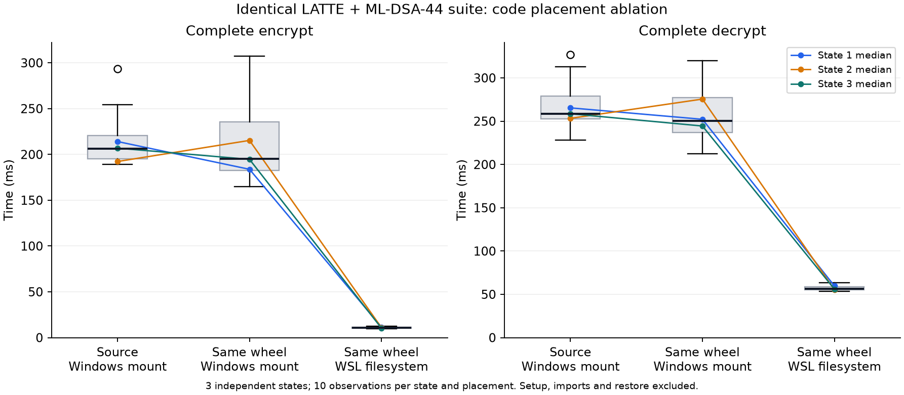

# 主展示组合：完整流程热点与 WSL 部署优化

本批完成 LATTE-3/COSAC-FIX＋BNN/ML-DSA-44＋Hybrid＋BYTEAUTH 的热点定位、实际运行优化和同参数消融。**完整 Encrypt 中位数由 206.087 ms 降至 10.921 ms，完整 Decrypt 由 258.640 ms 降至 56.360 ms**，分别为原来的约 1/18.87、1/4.59。收益属于本机 WSL 部署与文件访问开销；密码算法、参数、wire、随机数及校验步骤保持原样，不计新算法或密码学原创。

实施代码 `58102d1`，测量工具修正 `a175723`／`3ae9826`；正式测量固定源码 **`3ae9826b10795bea1c11b8f848c7ac90d1047843`**。本分支基于演示验收分支，未修改其它 AI 的 ABB／CHKP／IBS 参数文件，未启动暂缓路线。

## 发现与改动

独立 CLI 状态的 [cProfile 原记录](evidence/profile-source.json)显示：5 次完整 Encrypt 的 515 次 `read_bytes` 累计约 1.073 s，占该轮剖析 1.219 s 的约 88%。热点主要在每次创建原生适配器时读取、哈希、核对固定供应商源码；代码位于 Windows 盘的 WSL 挂载路径。本批保留逐次源码核对和 ABI／二进制检查，使用同一 wheel 在 WSL Linux 文件系统内的隔离运行副本。[WSL 剖析](evidence/profile-wsl.json)保留相同 515 次读取，累计约 0.011 s。剖析只用于定位，不用于下表的性能结论；剖析状态与正式三状态样本分开。

- [`wsl_wheel_runtime.py`](../../../experiments/research/wsl_wheel_runtime.py)：按 wheel SHA-256 建立 WSL 缓存，安装前检查成员路径，发布运行副本前及每次复用时核对 546 个内容文件和元数据（安装器重写的 RECORD 除外），拒绝改动及包内额外 Python provider；全局 Python 环境不变，不复制私钥或运行状态。失败安装保留 pending 目录。
- [`run_web_demo.sh`](../../../experiments/run_web_demo.sh)：新增显式 `--wheel` 入口，原有源码入口保留。运行版本固定为指定 wheel；修改仓库后须重新构建并指定新 wheel。
- [`full_system_placement.py`](../../../experiments/research/full_system_placement.py)：完整公共 API 的三路对照。HIBE／IBS／协议实现均未改动，无对象内部矩阵／陷门读取。

## 同条件实测与消融

原始数据为 [placement.json](evidence/placement.json)，包括全部 18 个进程块、逐次观察值、每状态中位数、完整参数和 provider 指纹。同一份 wheel 同时用于 Windows 安装目录与 WSL 安装目录；与仓库源码也逐文件核对相同。原生可执行文件在三路中共用 WSL 内的同一构建。

| 运行方式 | 完整 Encrypt，中位数 ms | 完整 Decrypt，中位数 ms | 每项观察次数 |
|---|---:|---:|---:|
| 仓库源码，Windows 盘 | 206.087 | 258.640 | 30 |
| 同一 wheel，Windows 盘（消融） | 195.310 | 250.577 | 30 |
| 同一 wheel，WSL Linux 文件系统 | **10.921** | **56.360** | 30 |



图中的连线是每个独立状态各自 10 次观察的中位数；箱线图展示原始观察分布。数据支持主要收益来自运行位置的判断，不能外推为 Linux 普遍比 Windows 快，或其它算法也有同等倍数。三个状态各自的加密提速约 17.67—20.11 倍、解密约 4.45—4.62 倍；30 次重复共享 3 个根，不作为 30 个独立密钥样本或置信区间。

计时覆盖公共输入／密钥校验、IBS 签名／验证、Hybrid、BYTEAUTH、完整密文编码／加载和原生子进程启动。导入、setup、持久化、恢复及独立计数诊断不混入 warm 单次时间。各状态按三路顺序轮转并镜像执行，6 个新进程块，每块 5 对完整加／解密，每路每状态 2 块；OS 缓存保留，未清空磁盘缓存。每次 Encrypt 使用新系统 CSPRNG；父／叶是同一固定发放状态。

完整密文实际为 **142,036—142,153 B**，未减少字段、压缩密文或改动身份顺序。每个块的独立诊断均为每对加／解密 6 次完整源码校验（LATTE 2、ML-DSA 4），15 次原生调用，5 次熵读取／65,644 B。18 个块的这些计数和 132 个已加载模块 SHA 完全相同；全部从原状态零熵恢复，操作后持久文件与接收钥不变。

本批只记录每个 worker 的 Linux 内核**进程寿命 RSS 高水位**，自身约 228.10—229.45 MiB；包含导入和恢复，不能当作单操作峰值或进程树物理内存。原始 `environment.rss_method` 是通用工具的固定文案；本实验没有启动其中提及的 10 ms 采样线程，以 `memory_scope` 和内核字段为准，不宣称内存下降。

## 参数、环境与可核查证据

完整 SuiteConfig 的 SHA 为 `10a23d28bfdf9b2e18b140149561c43d62f2649feb78b72510d350b419233346`：LATTE N=1024、q=68718428161、`seed32`，最多 2 个父身份／每父 2 个子身份，内层身份上限 86 B；IBS 为 ML-DSA-44 的既有 BNN 转换、reference 格式，身份上限 64 B、最多 16 身份。Hybrid 载荷上限 65,536 B；本次两侧身份各 64 B、应用消息 32 B。参数来源继续引用[原 LATTE 交付](../team-c-delivery/2026-10-14-latte-hibe/README.md)和[认证 IBS 交付](../team-c-delivery/2026-10-14-cert-mldsa/README.md)，未改用 debug／mock 预设。完整组合仍为研究执行配置，正式安全参数未准入。

Core Ultra 9 275HX，WSL2 Linux 6.18.33.2、指定 conda Sage 10.9／Python 3.13.14，OMP=4、OpenBLAS=1。固定 wheel SHA-256 为 `02627da062dc4f61bee084e93a2701e647de973306c0f87a6f4275e428e8efe9`；[打包文件清单](evidence/wheel-manifest.json)与 [native 运行后静态查询](evidence/native.json)保留源码 ABI、二进制 SHA。后者没有采样、发钥或签名，不冒称 worker 内实时二进制审计。

三份根在 2026-10-18 由 `58102d1` 的原统一 runner 各执行一次 Setup 并完成生成／恢复。开发时发现计数挂接与兼容模块别名核对问题后修正工具，2026-10-19 **沿用已成功的三份状态**，没有重新抽根、重发钥或筛掉算法失败；正式统计只包含修正后完整通过的 18 个块。原始生成摘要见 [generation.json](evidence/generation.json)，三份公开钥 SHA 不同。另一个 WSL 安装版新根完成 [15 步 CLI＋新进程零熵恢复](evidence/cli.json)：匹配解密、发送者／接收者／双方错配、改动／截断／追加／重复密文均符合预期。同身份重发不改变原状态。

只读核验 **3,449 项通过**，包括 541 个打包文件与固定 Git 字节完全一致、2,376 项三路加载 provider 核对及 CLI 的 131 个 provider。文件、参数、摘要、镜像顺序与恢复行为可用以下命令检查，不生成任何密钥：

```powershell
python docs/research/2026-10-19-full-system-placement/evidence/check.py
```

WSL 定向工具测试 7 passed；此前装配／BYTEAUTH／Hybrid／绑定回归 122 passed（含其中 6 项工具测试），无 skip。运行命令：

```sh
PYTEST_DISABLE_PLUGIN_AUTOLOAD=1 PYTHONPATH=src:. ~/miniconda3/envs/sage/bin/python -m pytest -q \
  tests/test_wsl_wheel_runtime.py tests/test_assembly.py tests/test_byteauth.py \
  tests/test_hybrid_hibe.py tests/test_hybrid_key_binding.py
# 122 passed
PYTEST_DISABLE_PLUGIN_AUTOLOAD=1 PYTHONPATH=src:. ~/miniconda3/envs/sage/bin/python -m pytest -q \
  tests/test_full_system_placement.py tests/test_wsl_wheel_runtime.py
# 7 passed
bash -n experiments/run_web_demo.sh
```

图可用指定 Sage Python 执行 [`plot.py`](evidence/plot.py)从 JSON 重画；Windows 测试用解释器缺少 matplotlib，作图已在指定 Sage 环境完成。公开收据的内容 SHA 和采集口径见 [provenance.json](evidence/provenance.json)；导出程序为 [collect.py](evidence/collect.py)，只读取公开收据和公开钥，不读取序列化秘密钥。

## 复跑与运行入口

在有 setuptools 的 Python 环境从选定源码构建本地包（本批在 Windows 构建，执行密码运算仍使用规定 WSL Sage）：

```sh
python -m pip wheel --no-deps --no-build-isolation --no-index --wheel-dir test-results/placement-wheel .
```

随后从仓库的 WSL 路径运行；已有独立 native 缓存时通过环境变量指定，首次需要时加 `--build-native`。`--wheel` 与后续应用参数之间的顺序如下：

```sh
bash experiments/run_web_demo.sh --build-native \
  --wheel "$PWD/test-results/placement-wheel/ibme-0.1.0-py3-none-any.whl" --port 8765
```

如仅使用当前已有引擎，省略 `--build-native`。副本默认在 `~/.cache/ibme-wheel-runtimes/<wheel-sha>/`，不占用现有源码 checkout；原生缓存默认遵循启动脚本。改过源码后重新打包，旧 wheel 的运行副本不会自动热更新。安装／校验是启动阶段开销，未计入 warm 提速。

正式消融使用原有引擎环境变量，依次设置 `IBME_LATTE3_EXECUTABLE` 与 `IBME_CERTIFIED_SIGNATURE_BIN_DIR`，然后：

```sh
PYTHONPATH=src:. OMP_NUM_THREADS=4 OPENBLAS_NUM_THREADS=1 \
~/miniconda3/envs/sage/bin/python -m experiments.research.full_system_placement \
  --source-root "$PWD" \
  --wheel "$PWD/test-results/placement-wheel/ibme-0.1.0-py3-none-any.whl" \
  --windows-runtime "$PWD/test-results/placement-windows-new" \
  --private-directory "$HOME/.cache/ibme-benchmarks/placement-new" \
  --source-commit <该次实际完整Git提交> --samples 5
```

以上默认新建 3 份状态且不覆盖已有目录；要复用完整成功状态，显式传 `--existing-generated <原生成目录>`，工具先核对全部原 provider。WSL Git 不能直接解析本 Windows worktree 的 `.git` 指针，提交 SHA 请在 Windows Git 查询后传入。wheel 重建时 ZIP 元数据可改变包 SHA，验收仍按实际包 SHA 和逐文件源码对应记录。

本机原状态和安装包均未进 Git。状态位置在 `~/.cache/ibme-benchmarks/full-system-hotspot-20261018-58102d1/generated/`，正式收据原件在 `.../full-system-hotspot-20261019-final/`，独立 CLI 状态在 `.../full-system-hotspot-20261019-cli/`；这些只是本机定位，公共重跑不依赖它们，不互传私钥文件夹。

## 交付边界

本批结束于一个有完整对照证据的部署优化。ABB／CHKP、其它 IBS 参数、最终三代表和发布包继续由各自任务推进；不将本机布局收益外推为它们的可行性结论。工作前提沿用所选算法安全、HIBE 身份匿名；理论材料引用原文。本批使用 ROM，未新增安全证明，安全元数据始终 **`none/false/false`**。功能与计时测试不证明密码学安全或授予 NIST 等级。

本批文件清单（相对仓库根；材料目录为 `docs/research/2026-10-19-full-system-placement/`）：

| 类别 | 文件 |
|---|---|
| 运行与测量 | `experiments/research/full_system_hotspots.py`、`full_system_placement.py`、`wsl_wheel_runtime.py`，`experiments/run_web_demo.sh` |
| 测试 | `tests/test_wsl_wheel_runtime.py`、`tests/test_full_system_placement.py` |
| 当前入口 | `docs/PROJECT_STATUS.md`、`src/ibme/webui/README.md` |
| 交付材料 | 本 `README.md`；`evidence/placement.json`、`profile-source.json`、`profile-wsl.json`、`cli.json`、`generation.json`、`native.json`、`wheel-manifest.json`、`provenance.json` |
| 复核与作图 | `evidence/collect.py`、`check.py`、`plot.py`、`timing.png`、`timing.svg` |
