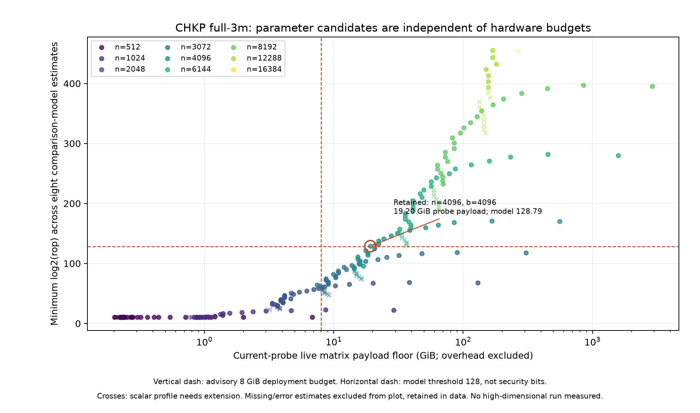

# CHKP 3m高基数参数筛选：保留候选，硬件单独分档

本批完成288组完整参数投影、2304次比较模型调用，并找到**66组参数研究候选**。其中当前探针矩阵payload估算最小的是 **n4096、基数4096、q93位，父R约9 GiB**。它超过本机当前WSL内存，但保留为后续实现候选；**本机跑不了不等于算法不可行**。当前探针的对象存活方式、算术profile和硬件预算分别记录，不能互相替代。

数学/模型源码冻结于 `93b8d5fecb175dcdffda3e7e8c8b32378a2bbe4e`；用户明确硬件口径后，`a709e82c01bd30db590452cef6f0401d8e8c3635` 将8 GiB硬淘汰改为部署参考。原始q、宽度、有限证书和全部估计值原样复用，**没有重算或选择性替换模型结果**。[原始收据](evidence/original-screen.json.gz)保留历史决策，[新决策完整收据](evidence/screen.json.gz)和[可读汇总](evidence/summary.json)代表当前结论；两次提交与输入SHA分别记录。

## 得到了什么

| 同为n4096的自洽参数组 | q位数 / gadget位数 | 根模型最低指数 | 密文模型最低指数 | 父R固定宽度编码估算 | 当前探针存活矩阵payload估算 |
|---|---|---:|---:|---:|---:|
| 原二进制 b2 | 77 / 77 | 171.190 | 170.130 | 487.266 GiB | 555.880 GiB |
| 保留余量方案 b1024 | 89 / 9 | 137.800 | 137.270 | 10.969 GiB | 22.166 GiB |
| 最小payload候选 b4096 | 93 / 8 | 129.320 | 128.790 | 9.000 GiB | 19.197 GiB |

指数是每种角色的primal-uSVP/dual、经典/量子四项估计的最小log2(rop)。128只是本次比较模型筛选阈值，**不表示实际HIBE安全位数或NIST等级**。b4096的模型余量较小，因此同时保留b1024。父R约54倍的缩减来自不同基数、宽度和重新选择q后的两组参数，不是同一个私钥文件的压缩实测，也不增加论文算法实例数。

b4096精确组：`q=5998976077229064136548861031`（已证明素数），`k=8,w=32768,m=40960,Dparent=49152,Dleaf=122880`。父R有1,610,612,736项，按原固定公共界编码规则每项6 B，加头共9,663,676,482 B；新基数outer codec尚未实现。该组有限概率账本落在 `(2^-132,2^-131]`，前提为所列精确算术、理想随机流和资源条件；不包含整操作熵帽、求解/OS资源中止或安全归约损失。

**计算量也需实测。** 仅一份父R的逐列proposal就至少有1,610,612,736次标量draw；现有dense公式逐列完成父生成的最后Rz共8,796,093,022,208个逻辑标量乘积，256个叶的最后Rz共412,316,860,416个。这些是公式工作量计数，未计拒绝/其它步骤，也不是任何优化算法的时间下界。不能据此给出秒数，或保证加内存即可运行。

## 硬件是部署条件

当前探针同时保留根/父/固定256叶及H1/H2，b4096的矩阵payload估算为19.197 GiB；其中持久对象合计15.447 GiB。它们都不是必须同时驻留的算法内存下界。释放已用状态、公共块复用、分块或外存计算，以及更大内存环境，均可作为下一步实际实现与测量的选择；本批没有提前验证这些节省量。

| 参考内存量 | 66组候选中，当前探针payload不超过该量的组数 |
|---|---:|
| 8 GiB研究预算 | 0 |
| 16 GiB | 0 |
| 32 GiB | 6 |
| 64 GiB | 27 |
| 128 GiB | 45 |
| 本机WSL总量16,479,084,544 B（约15.35 GiB） | 0 |
| 本机Windows物理总量33,778,278,400 B（约31.46 GiB） | 6 |

以上仅比较矩阵字节数；未计Python/context拷贝、metadata、cache、工作区与OS，也未假定整机总量全部可供一个进程。**32 GiB一栏不是“32 GiB保证能跑”**。没有调整用户WSL内存或发起这些高维密钥生成。时间和实际RSS均保留null。



## 搜索边界与未知项

预定n={512,1024,2048,3072,4096,6144,8192,12288,16384}，基数b=2^a、a=1..32，共288组。保留CHKP作者稿完整3m叶、计算型前导单位阵根、两块完整H和现有Frobenius充分配方；每组重新传播根→父→叶→噪声→最小通过素数q。原文位置和公式见[规范](../../../specs/mp12-radix-screen.md)。没有改成2m、缩掉H、引入紧谱界或增加证明任务。

固定Estimator `53da5982597709ba0fdf94ea37a84d822310fd84`，根和密文分别建模，每组8项，共2304项：1946项有限估计、176项无有限估计、182项报错。错误文本和耗时全部保留；未知结果不算成本无限大。288组中148组比较模型成本低于阈值、46组至少一项模型未知、28组通过模型但需要扩展标量profile，另66组同时满足比较模型、原标量域和条件式概率筛选。候选分布为n4096/6144/8192/12288各12/24/23/7组，全部保留。

根使用单列Gaussian比较模型；密文使用前导误差normal form、全部2m个H块样本的DiscreteGaussian比较模型，未声称等于字面rounded noise分布。有限配置为epsilon/tail/abort192、mass320、precision384、拒绝帽256/192、扰动512；256目标、32 B seed、每层86 B身份、2×2树及2^20次封装/H/G查询。公共kernel只建k平方阶矩阵；熵/标量采样/GPV采样方法运行时被禁止，0次根生成、0次采样、0 B私有熵、0个完整高维矩阵分配。

## 验证与交接

指定环境为WSL `~/miniconda3/envs/sage/bin/python`，Sage10.9/Python3.13.14、OMP4/OPENBLAS1、Core Ultra9 275HX；只读内存快照见[环境](evidence/environment.json)。根HIBE为ROM工作口径；沿用用户确定的算法安全和身份匿名前提，以论文引用推进工程。本批全部安全元数据仍为`none/false/false`，未修改默认后端、registry、wire或协议。三条暂缓路线继续暂缓。

最终定向检查：

```sh
PYTHONPATH=src:. PYTEST_DISABLE_PLUGIN_AUTOLOAD=1 OMP_NUM_THREADS=4 OPENBLAS_NUM_THREADS=1 \
~/miniconda3/envs/sage/bin/python -m pytest -q \
 tests/test_mp12_radix_screen.py tests/test_mp12_target_screen.py tests/test_prime_gadget.py
# 65 passed / 0 skipped，a709e82
```

Windows `PYTHONPATH=src;.`、`python -m pytest -q tests/test_ci_catalog.py`：25 passed / 0 skipped，初始筛选提交93b8d5f；该目录文件在a709e82未变。[JUnit收据与命令](evidence/tests.json)逐批记录，不把它们称为整个A后端重跑。新测试覆盖二进制退化一致性、q重新选择、公开基完备/GS、无采样、未知模型，以及硬件预算改变不淘汰候选、重分类不改数学/模型证据。

公开证据审计：Windows `python docs/research/team-a-delivery/2026-10-18-radix-screen/evidence/verify.py`，原/新收据46+46个provider、另批Falcon完整评测780个provider全部对应各自Git源码；288组数学/有限/模型逐字段相同。见[审计收据](evidence/verification.json)。这是本批自审，不冒称另一位密码学审查者独立安全评审。

`evidence/analyze.py`从完整新决策、原收据和环境生成gzip/汇总/图；复跑顺序见规范。代码提交信息与完整修改文件列表见[清单](evidence/changed-files.json)。所有公开结果及脚本随本分支提交；私有状态未提交。跨边界仅在`ci/suites.json`给现有A套件加入公开测试，以及更新统筹状态/完整系统评测材料；未改他人原语文件。

本批尚未交付高基数完整采样后端、对象codec、目标维度根/父/叶实跑及完整KEM/CLI，也没有目标维度时间/RSS。下一工程验证以b4096和b1024为起点，先接入任意基数公开kernel与完整扰动采样、逐级实跑，再测对象存活改造与大内存环境；不能把这些待办改写为候选被本机硬件淘汰。全部全局任务排序以[PROJECT_STATUS](../../../PROJECT_STATUS.md)为准。
